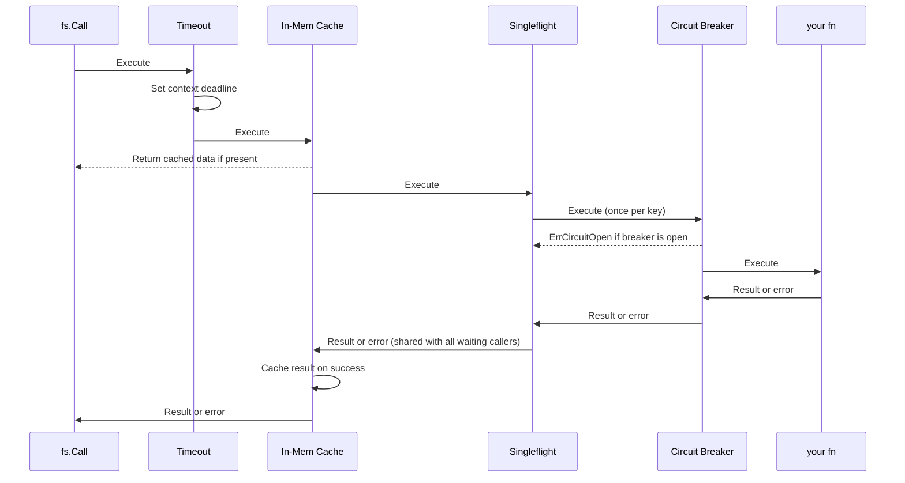

# go-failsafecall

[](https://pkg.go.dev/github.com/rizanw/go-failsafecall)
[](LICENSE)

A small Go wrapper that makes external calls (HTTP, gRPC, database, cache) resilient by combining four distributed-systems patterns behind a single `Call` function. Turn each one on with configuration, without changing your call sites:

- **Timeout**: cancel calls that take too long
- **In-memory LRU cache**: serve repeated reads without hitting the upstream
- **Singleflight**: collapse concurrent identical requests into one upstream call
- **Circuit breaker**: stop calling an upstream that is failing, and let it recover

```go
resp, err := fs.Call(ctx, "user:42", func(ctx context.Context) (interface{}, error) {
    return userClient.Get(ctx, 42)
})
```

## Installation

```bash
go get github.com/rizanw/go-failsafecall
```

Requires Go 1.21 or newer.

## Quick start

**1. Create a wrapper** with the features you need. A `nil` config disables a feature, and an empty config enables it with defaults.

```go
import (
    "database/sql"

    "github.com/rizanw/go-failsafecall"
)

fs := failsafecall.New(failsafecall.Config{
    CallTimeout:  500, // milliseconds
    Singleflight: true,
    CBConfig: &failsafecall.CBConfig{
        OpenTimeoutSec:             60,
        HalfOpenMaxRequests:        2,
        CloseFailureRatioThreshold: 0.5,
        CloseMinRequests:           10,
        WhitelistedErrors:          []error{sql.ErrNoRows}, // "not found" isn't an outage
    },
    CacheConfig: &failsafecall.InMemCacheConfig{
        TTLSec: 3600, // 1 hour
    },
})
```

**2. Wrap your calls.** The key identifies the request for caching and singleflight, so give each distinct request its own key.

```go
resp, err := fs.Call(ctx, fmt.Sprintf("post:%d", id), func(ctx context.Context) (interface{}, error) {
    return getPost(ctx, id) // use ctx so the timeout applies
})
if err != nil {
    return nil, err
}
post := resp.(*Post)
```

## How a call flows

With every feature enabled, a call passes through the layers in this order:



The order matters:

- **Cache before everything**, so cached reads never touch the network or count against the breaker.
- **Singleflight outside the circuit breaker**, so ten concurrent callers sharing one upstream call count as one request, not ten. Otherwise a single failure would be counted ten times and could open the breaker on its own.
- **Only successful results are cached.** Errors are returned to every waiting caller and never stored.

## Patterns

### Timeout

Wraps the call in `context.WithTimeout`. Your function must pass `ctx` to the client it calls (for example `http.NewRequestWithContext`) for the deadline to take effect.

### In-memory LRU cache

Backed by [ccache](https://github.com/karlseguin/ccache), a sharded LRU cache. Use it for data that is read often and changes rarely, such as configuration, reference data, or user profiles. Avoid it for data that must always be fresh or for write-heavy workloads.

### Singleflight

Backed by [`golang.org/x/sync/singleflight`](https://pkg.go.dev/golang.org/x/sync/singleflight). When many goroutines request the same key at the same time, only the first one calls upstream and the rest wait for its result. This protects upstreams from bursts and cache stampedes.

The shared call runs with the context of the first caller, so if that caller's context is cancelled, everyone waiting on the same key receives the error.

### Circuit breaker

Backed by [gobreaker](https://github.com/sony/gobreaker). After `CloseMinRequests` requests, if the failure ratio reaches `CloseFailureRatioThreshold`, the breaker opens and calls fail fast with `ErrCircuitOpen` instead of waiting on a broken upstream. After `OpenTimeoutSec` it lets `HalfOpenMaxRequests` trial requests through, and closes again if they succeed.

Use `WhitelistedErrors` for errors that are a normal result rather than an outage, such as `sql.ErrNoRows`. They're still returned to you but don't count as failures.

```go
resp, err := fs.Call(ctx, key, fetch)
if errors.Is(err, failsafecall.ErrCircuitOpen) {
    return fallbackValue, nil // upstream is down, degrade gracefully
}
```

## Configuration

### Config

| Field | Type | Description |
|---|---|---|
| `CallTimeout` | `int64` | timeout for each call, in milliseconds (0 disables) |
| `Singleflight` | `bool` | enables singleflight (requires a non-empty key) |
| `CBConfig` | `*CBConfig` | circuit breaker settings (`nil` disables) |
| `CacheConfig` | `*InMemCacheConfig` | in-memory cache settings (`nil` disables, requires a non-empty key) |

### CBConfig

| Field | Type | Default | Description |
|---|---|---|---|
| `OpenTimeoutSec` | `int` | 60 | how long the breaker stays open before going half-open |
| `HalfOpenMaxRequests` | `int` | 1 | trial requests allowed while half-open |
| `CloseFailureRatioThreshold` | `float64` | 0.5 | failure ratio that opens the breaker |
| `CloseMinRequests` | `int` | 10 | minimum requests before the ratio is evaluated |
| `WhitelistedErrors` | `[]error` | `nil` | errors that don't count as failures (matched with `errors.Is`) |

### InMemCacheConfig

| Field | Type | Default | Description |
|---|---|---|---|
| `TTLSec` | `int` | 1 | how long an entry stays fresh, in seconds |
| `MaxSize` | `int` | 5000 | maximum number of entries |
| `Buckets` | `int` | 16 | number of shards (power of 2) for concurrency |
| `GetsPerPromote` | `int` | 3 | reads before an entry is moved up the LRU list |
| `ItemsToPrune` | `int` | 500 | entries evicted at once when the cache is full |

### Per-call options

Override the configured timeout or cache TTL for a single call:

```go
resp, err := fs.Call(ctx, key, fetch, failsafecall.WithTimeoutDeadline(30)) // 30 ms
resp, err := fs.Call(ctx, key, fetch, failsafecall.WithCacheTTL(30))        // 30 s
```

### Errors

| Error | Returned when |
|---|---|
| `failsafecall.ErrCircuitOpen` | the breaker is open and the call was rejected |
| `failsafecall.ErrTooManyRequests` | the breaker is half-open and its trial requests are used up |
| `context.DeadlineExceeded` | the call exceeded its timeout (if your function honors `ctx`) |

## Examples

The [`example`](example) folder has a runnable demo of each feature, all calling a public JSON API:

| Example | Shows |
|---|---|
| [`repo.go`](example/repo.go) | wrapping an HTTP call with `fs.Call` |
| [`timeout.go`](example/timeout.go) | cancelling slow calls |
| [`singleflight.go`](example/singleflight.go) | collapsing concurrent requests for the same key |
| [`cache.go`](example/cache.go) | serving repeated reads from memory |
| [`circuitbreaker.go`](example/circuitbreaker.go) | failing fast after repeated errors |

```bash
cd example && go run .
```

## References

- [Circuit Breaker pattern](https://learn.microsoft.com/en-us/azure/architecture/patterns/circuit-breaker), Microsoft Azure Architecture Center
- [LRU cache](https://redis.io/glossary/lru-cache/), Redis
- [Go singleflight](https://victoriametrics.com/blog/go-singleflight/), VictoriaMetrics
- [context.WithTimeout](https://pkg.go.dev/context#WithTimeout), Go documentation

## License

[MIT](LICENSE)
